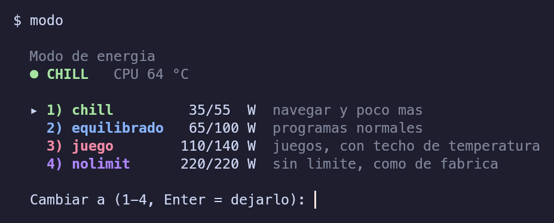

# ThermalTools v2

Modos de energía a medida para un portátil Intel en Linux. Sustituye a la herramienta del
fabricante con algo que se puede leer, ajustar al vatio y que cambia solo al abrir un juego.

<p align="center"></p>

| Modo | PL1 / PL2 | Perfil | Para |
|---|---|---|---|
| 🟢 **chill** | 35 / 55 W | `power-saver` | navegar y poco más, portátil sobre las piernas |
| 🔵 **equilibrado** | 65 / 100 W | `balanced` | programas normales |
| 🔴 **juego** | 110 / 140 W | `performance` | juegos, con techo para no llegar a Tjmax |
| 🟣 **nolimit** | 220 / 220 W | `performance` | como de fábrica (pide confirmación) |

Los valores son los de un i9-13950HX con RTX 4060. **Se cambian en un fichero de texto**
(`~/.config/thermaltools/modos.conf`), no en el código.

En la barra de KDE Plasma, un widget muestra la temperatura de la CPU con el color del modo:

<p align="center"></p>

## Por qué

Un i9 de la serie HX viene de fábrica con **PL1 = PL2 = 220 W** y ningún límite real: acelera
hasta chocar con los 100 °C. En un portátil eso pasa en segundos, haga lo que haga.

Medido en este equipo, con todos los hilos al 100 % durante 15 s:

| | Fábrica (220 W) | chill (55 W) |
|---|---|---|
| Frecuencia P-cores | 4400 MHz | 2600 MHz |
| Temperatura CPU | 58 → 97 °C en 20 s | **68 °C estable** |

Y jugando no hace falta tanta CPU: el juego va limitado por la GPU (93-100 % de uso), la CPU
usa unos 4 hilos de 24 y comparte disipador con la GPU. Cada vatio que la CPU no gasta es
calor que la GPU no tiene que compartir.

### Limpiar no basta

Tras limpiar ventiladores y cambiar la pasta térmica por una lámina de cambio de fase
(misma partida, misma carga de GPU, ~92 W):

| | Antes | Después |
|---|---|---|
| GPU | 86 °C | **76 °C** |
| CPU | 92,6 °C | 90 °C, y a los 3 min tocó 99 °C |

La GPU mejora 10 °C; la CPU casi nada. No es un problema de evacuar el calor, es de
**generarlo**: con 220 W disponibles, la CPU se los come. Por eso esto va de vatios.

## Instalación

```bash
git clone https://github.com/avidosa/ThermalTools.git
cd ThermalTools
./instalar.sh                # comandos en ~/.local/bin, config, servicio y widget (sin root)
sudo ./instalar-permisos.sh  # una vez: grupo powercap + regla udev
```

Cierra sesión y vuelve a entrar (para coger el grupo) y escribe `modo`. El widget se añade
con clic derecho en el panel → *Añadir widgets* → **Modo y temperatura**.

Requisitos: Intel con `intel-rapl` en `/sys/class/powercap`, `power-profiles-daemon`,
`nvidia-smi` para detectar juegos (opcional) y KDE Plasma 6 para el widget (opcional).

Desinstalar: `./instalar.sh --quitar` y `sudo ./instalar-permisos.sh --quitar`.

## Uso

```bash
modo                 # menú: modo actual en color y a cuál cambiar
modo chill           # cambiar directamente
modo --barra         # "chill 63": lo que lee el widget
prueba-termica 30    # registrar 30 min de temperaturas con guardián (ver abajo)
```

Con **chill** o **equilibrado** elegido, al abrir un juego `modo-juego` sube solo a
**juego** y al cerrarlo vuelve. El juego se detecta por la VRAM que ocupa un proceso, no por
una lista de nombres. Con **juego** o **nolimit** elegidos, el modo se queda fijo.

El modo elegido sobrevive a los reinicios. El vigilante además lo reaplica cada 5 s, porque
algunos firmwares restablecen PL1/PL2 al enchufar o desenchufar el cargador.

## Seguridad

Escribir PL1/PL2 es cosa de root. En lugar de un servicio con root o un `sudo` sin
contraseña, la v2 da el permiso mínimo:

- **Una regla udev** cambia el grupo de exactamente dos ficheros (`constraint_0` y
  `constraint_1` de `intel-rapl:0` e `intel-rapl-mmio:0`) a `powercap` con `0664`. Nada más:
  ni otros dominios, ni `energy_uj` (que sigue siendo de root por la mitigación Platypus).
- **Grupo propio**, no el del usuario. Quien no esté en `powercap` no puede tocar nada.
- **`modos.conf` se parsea, no se ejecuta**: no hay `source`. Solo se aceptan los cuatro
  nombres conocidos, enteros entre 5 y 300 W con PL2 ≥ PL1 y perfiles de una lista cerrada.
  Las líneas no válidas se ignoran y se avisa.
- **Riesgo que queda, dicho claro:** cualquier proceso que corra como tu usuario puede
  cambiar esos dos límites. El peor caso es dejar la CPU como viene de fábrica o muy lenta;
  no da escalada de privilegios. Si eso no te vale, no instales `instalar-permisos.sh` y
  usa `sudo modo ...`.
- Todo es reversible: los límites vuelven a los de fábrica al reiniciar sin el servicio, y
  ambos instaladores tienen `--quitar`.

## Herramientas de diagnóstico

### `prueba-termica` — medir con red de seguridad

Registra cada 2 s temperatura de CPU y GPU, vatios, frecuencias, ventiladores, VRAM,
eventos de *throttling*, cargador y perfil, en un CSV que se **sincroniza a disco en cada
línea** (si el equipo se apaga, el registro llega hasta el último segundo).

Con un juego abierto actúa de **guardián** y lo cierra si la CPU toca 99 °C, si pasa 6 s
por encima de 97 °C, si la GPU pasa 6 s por encima de 88 °C o si se desenchufa el cargador.
Los umbrales son variables de entorno (`CPU_CORTE`, `CPU_AVISO`, `GPU_AVISO`).

Lección que costó aprender: **una medida suelta no vale**. A los 5 minutos de partida la
CPU estaba a 84 °C y parecía asumible; a los 31 minutos, con el chasis saturado, estaba a
92-100 °C. Hay que medir media hora de carga real.

### `caja-negra.sh` — saber a qué temperatura murió

Registro mínimo de temperatura y VRAM con volcado inmediato. Ver `herramientas/`.

## v1 (septiembre 2026)

En `v1/` queda el primer intento: `cpu-cool.sh`, un anillo de seguridad con reparto
dinámico de vatios entre CPU y GPU, y `vigilante-96.sh`. Funcionaban, pero bajaban el calor
bajando el rendimiento en bruto. La v2 es más simple: límites fijos por modo y que el
usuario decida.

**Corrección al diagnóstico de la v1.** La v1 descartaba el calor como causa de los apagones
(la CPU iba a 77-83 °C con el perfil `balanced`) y apuntaba a un pico eléctrico. Con el perfil
`performance` el régimen cambió: un apagón posterior quedó grabado con 31 min a 92 °C de
media, 14 muestras en 100 °C y ni una sola muestra con la batería ayudando a la fuente. **Un
diagnóstico térmico caduca al cambiar el perfil de energía.**

## Antes de usarlo en otro equipo

Los vatios de `modos.conf` son de una CPU concreta. Empieza por los de ejemplo, mide con
`prueba-termica` y ajusta. Esto toca límites de potencia reales del procesador: léete los
scripts antes de darles permisos. Son cortos a propósito.
